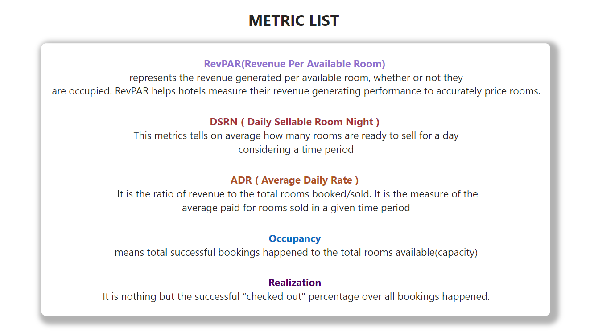

# Hospitality Revenue Analysis (Power BI)

A Power BI dashboard on hotel revenue and performance KPIs across properties in four Indian cities.

## What it does

- KPI cards for Revenue, RevPAR, ADR, Occupancy %, DSRN and Realisation %.
- Weekly trend of RevPAR and ADR (weeks 19 to 31, May to July), with a week selector.
- Revenue split by city (Mumbai, Bangalore, Hyderabad, Delhi) and by room category (Luxury, Business).
- Per-property table with revenue, RevPAR, occupancy, ADR, DBRN, DSRN, DURN, realisation, cancellation % and average rating.
- Booking share by platform and ADR vs RevPAR by city, with month, city and room-type filters.

## Key metrics

- **RevPAR** (Revenue Per Available Room): revenue generated per available room, occupied or not.
- **DSRN** (Daily Sellable Room Nights): on average, how many rooms are ready to sell per day over a period.
- **ADR** (Average Daily Rate): revenue divided by rooms booked or sold.
- **Occupancy**: successful bookings divided by total rooms available (capacity).
- **Realisation**: the share of all bookings that were successfully checked out.

## Built with

- Microsoft Power BI Desktop
- Power Query for data preparation and transformation
- A data model with DAX measures for the KPIs

## Open it

1. Install [Power BI Desktop](https://powerbi.microsoft.com/desktop/) (Windows).
2. Download `keren.pbix` from this repository.
3. Open it in Power BI Desktop and use the month, city and room-type filters.

## Project status

Portfolio dashboard. This is an analytical project; findings should be interpreted in the context of the supplied dataset and its assumptions.

---

Part of [Aryan Gupta's projects](https://github.com/AryanGupta-234). Building [NOBAD](https://nobad-platform.aassworld99.workers.dev/): software with a point of view.
